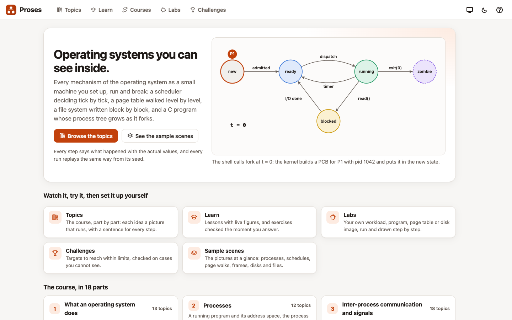
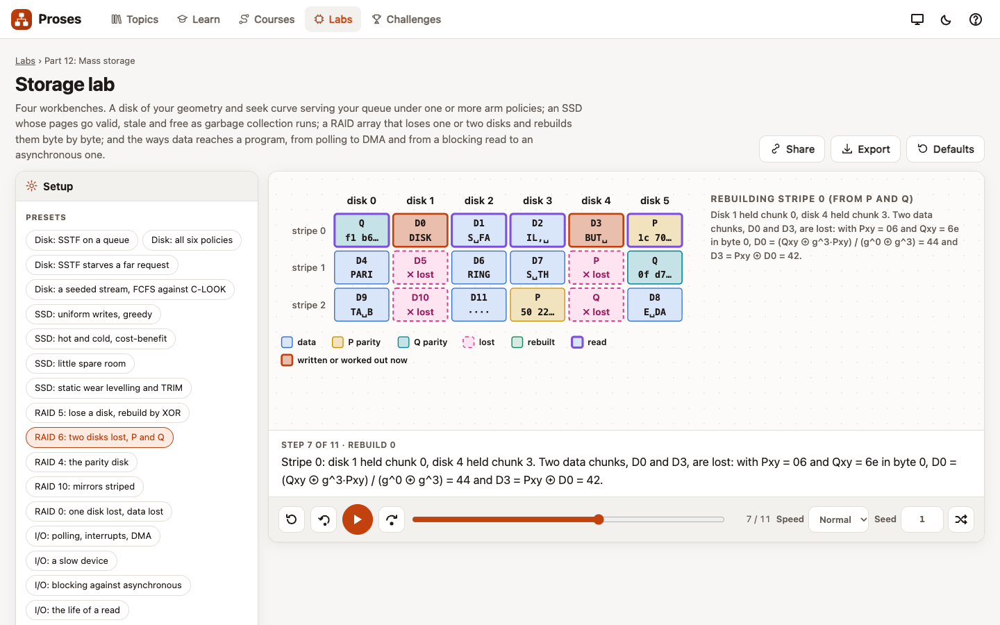
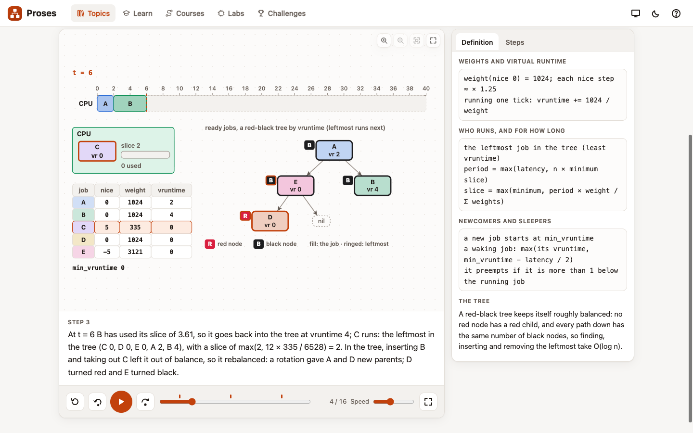
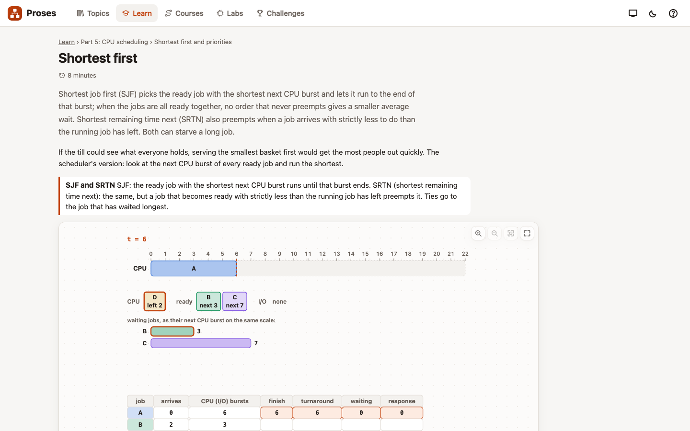
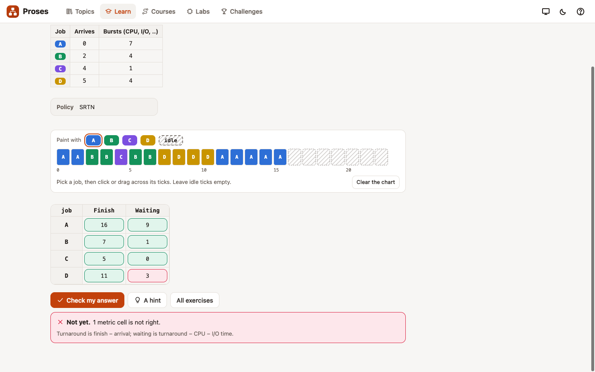
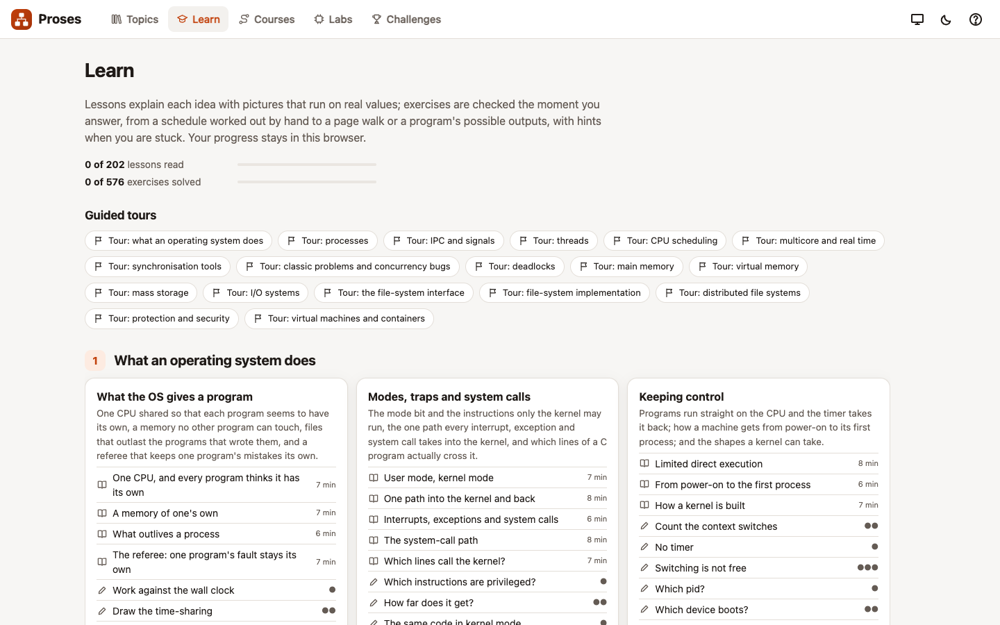
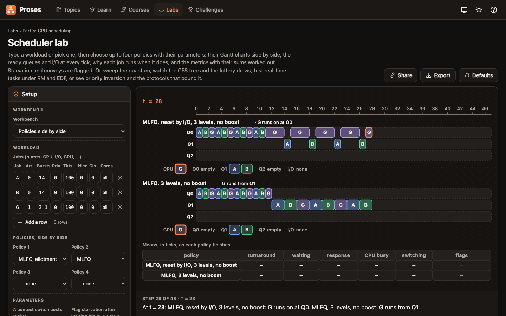
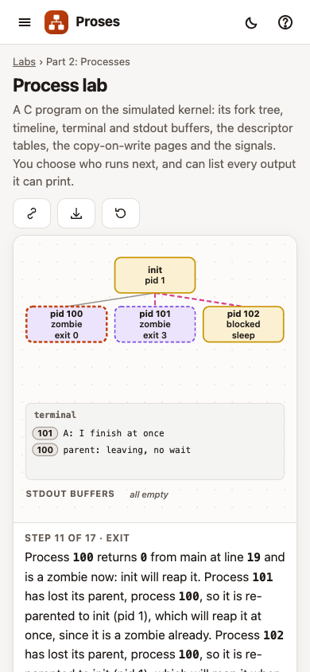

# Proses

Proses is operating systems you can see inside. Every mechanism of the course is a small
machine you set up, run a step at a time and break: a scheduler deciding tick by tick on a
workload you typed, a four-level page table walked with the bit split you chose, a file system
on a disk image you watch block by block while the power is cut under it, and a C program
whose process tree grows as it forks. Under every picture a sentence says what that step did,
with the actual values: "P3 preempts P1 at t = 7: its remaining 2 is less than P1's 5".

Students meet operating systems as definitions and diagrams that never move. They can recite
the states of a process, the steps of a page walk or the rows of the banker's algorithm, but
they have rarely watched one happen, and a fork program that prints in a surprising order
stays a puzzle. On a whiteboard I can work one schedule or one walk by hand; the next
question, "and with a quantum of 3?", means starting again. In Proses every input is the
student's to change and the picture follows. The C programs run in an interpreter written
for the tool, on a simulated kernel that draws everything it does, so a student can ask how
many different outputs a program can print and see the schedule behind each one. And the
engines are checked against real programs compiled and run on a real machine, so what you see
is what the system does.

The course is defensive where it touches security. Setuid programs, password storage, buffer
overflows and isolation are taught as concepts together with their defences (least privilege,
salted and slowed hashes, rate limits and a second factor, stack canaries, non-executable pages
and address randomisation, sandboxes), and never as a recipe against a real system.

The course is about concepts, not kernel source. When you want to see the same ideas in the
code of a real kernel, [xv6, line by line](https://xv6.jyotiprakash.org) is the companion.

Live at https://proses.jyotiprakash.org



## What it is

Proses is one HTML file. There is nothing to install and nothing is sent anywhere; your
programs, workloads, disk images, answers and progress are kept in the browser. Under the page
are engines written for it:

- a C front end (a preprocessor, a parser for a real subset of C and type checking with clear
  messages) and an interpreter that runs on byte-addressed memory, one per process, so
  pointers, arrays, structs and casts behave as they do in C, and undefined behaviour (out of
  bounds, use after free, an uninitialised read, a missing return) is caught and explained;
- a simulated kernel behind the calls students really write: fork, exec, wait and waitpid,
  exit, pipes, dup and dup2, open, read, write and lseek, signals with masks and handlers,
  alarm and pause, process groups and job control, pthreads, mutexes, condition variables and
  semaphores, and stdio with the real buffering rules (a line at a time on a terminal, a
  buffer at a time on a pipe), with copy-on-write after fork and zombies reaped by init;
- a model checker that explores every interleaving of a small program, with state hashing
  and partial-order reduction, and for larger ones bounded preemptions and seeded random
  schedules, and replays any failing schedule a step at a time;
- every scheduler of the course (FCFS, SJF, SRTN, priority with aging, round robin, the
  multilevel queue and the feedback queue, lottery, stride, a CFS-style scheduler with its
  red-black tree, several cores, rate-monotonic and EDF, and priority inversion with
  inheritance and the ceiling), each a pure function from a workload to a trace;
- page tables of every shape (linear, any number of levels, hashed, inverted), a TLB, the
  replacement policies, working sets, contiguous allocation, segmentation, the buddy system,
  slabs and malloc;
- a disk with a seek curve and the arm policies, an SSD with its translation layer, RAID 0,
  1, 1+0, 4, 5 and 6 over real bytes (with P and Q in GF(2⁸)), and error-detecting codes;
- a block file system with a geometry of your choosing, five allocation methods, fsck,
  journaling in three modes, copy-on-write and log-structured modes, and NFS-style and
  AFS-style distributed caching on a timeline;
- the banker's algorithm, allocation and wait-for graphs, protection and virtual machines.

Every operation a student can watch returns a trace of its steps, and every picture is drawn
from that trace. Schedules, interleavings and workloads come from visible seeds, and the same
seed always replays the same run.

There are 255 topics in 102 families, in eighteen parts, which follow the usual order of an
operating-systems course:

1. **What an operating system does** (13 topics in 7 families): one CPU that every program
   thinks is its own, the same address in two processes, files that outlive their writers,
   the OS as referee, user and kernel mode and privileged instructions, a trap step by step,
   interrupts, exceptions and system calls compared, the system-call path, which lines of a C
   program call the kernel, limited direct execution and the timer, booting from firmware to
   init, and kernel designs side by side.
2. **Processes** (12 in 5): the address space, the process control block, the state diagram
   live, the context switch, fork returning twice, counting the processes in a fork tree,
   exec, wait and the exit status, zombies, orphans and init, copy-on-write after fork, why a
   printf can print twice, and every order a program can print in.
3. **Inter-process communication and signals** (18 in 5): a pipe between parent and child,
   descriptor tables after fork, dup, dup2 and redirection, named pipes, a shared-memory ring,
   message passing, signals and handlers, the mask and the pending set, SIGCHLD, kill and
   alarm, sockets, a remote procedure call byte by byte, at-least-once and at-most-once, and a
   shell: read, fork, exec and wait, pipelines, redirection, background jobs and job control.
4. **Threads** (12 in 5): threads against processes, what threads share, the three
   threading models, pthread_create and join, thread-local variables, cancellation, a thread
   pool, fork-join, a parallel loop, Amdahl's law, and fork and exec in a threaded program.
5. **CPU scheduling** (16 in 6): bursts and metrics, FCFS and the convoy, SJF, SRTN,
   predicting the next burst, priorities, starvation and aging, round robin and the quantum,
   the multilevel queue, the feedback queue and how a program games it, lottery, stride, the
   fair scheduler with its red-black tree, and every policy on one workload.
6. **Multicore and real-time scheduling** (11 in 4): one queue or one per core, push and
   pull balancing, affinity, periodic tasks, rate-monotonic, EDF, utilisation bounds,
   response-time analysis, the processor-demand test, and priority inversion with inheritance
   and the ceiling.
7. **Synchronisation tools** (18 in 6): count++ as three steps, every interleaving as a tree,
   the race in real C, the critical-section problem, Peterson's algorithm and a machine that
   reorders memory, test-and-set, compare-and-swap and fetch-and-add, spinlocks, ticket and
   queue locks, a mutex and its sleep queue, semaphores, condition variables and the while
   loop, monitors, a counter, a list and a hash table locked three ways, and how the model
   checker searches.
8. **Classic problems and concurrency bugs** (15 in 6): the bounded buffer with semaphores
   and with condition variables, two ways to break it, readers and writers with starvation
   made visible, dining philosophers and three fixes, clean and dirty forks, the sleeping
   barber, the cigarette smokers, barriers, crewing the boats, atomicity and order violations,
   lost wake-ups, and the event loop.
9. **Deadlocks** (14 in 5): the allocation graph live, finding a cycle, the wait-for graph,
   the four conditions each switched off in turn, prevention, safe states row by row, the
   banker granting or refusing a request, claim edges, detection with many units, recovery by
   abort or rollback, two locks in opposite orders, a lock-order checker, and livelock.
10. **Main memory** (15 in 6): base and bounds, swapping, first, best, worst and next fit,
    compaction, segmentation, the address split, internal fragmentation, the TLB, ASIDs, the
    effective access time and TLB reach, walking a multilevel table, how much memory the
    tables take, and hashed and inverted tables.
11. **Virtual memory** (20 in 8): the page-fault path, demand paging, copy-on-write and
    zero-fill, memory-mapped files, every replacement policy step by step and side by side,
    Belady's anomaly, reference strings with locality or traced from a C program, sharing out
    the frames, global and local replacement, thrashing, the working set, page-fault
    frequency, the buddy system, slabs, malloc and free, and choosing a page size.
12. **Mass storage** (15 in 5): cylinders, heads and sectors, seek, rotation and transfer,
    the disk arm under every policy, flash pages, garbage collection and wear levelling, RAID
    layouts, parity bit by bit and the small write, a failed disk rebuilt, RAID 6 in GF(2⁸),
    checksums, a CRC as long division, and Hamming(7,4).
13. **I/O systems** (14 in 5): the bus and the controllers, device registers, polling,
    interrupts and DMA compared, blocking, non-blocking and asynchronous reads, buffering, the
    buffer cache, spooling, the request queue, the life of a read, and the two halves of a
    driver.
14. **File-system interface** (12 in 5): a file, its inode and its blocks, access methods,
    the descriptor, open-file and inode tables, fork sharing an offset, directory structures,
    path lookup, hard and symbolic links, unlinking an open file, mounting, and permission
    bits.
15. **File-system implementation** (17 in 9): the on-disk layout, the blocks each command
    changes, five ways to allocate, walking an inode to byte N, free space, lookup and the
    cost of each operation, the buffer cache, cylinder groups, the order of updates and fsck,
    journaling in three modes, checkpoint and replay, copy-on-write trees and checksums, a
    log-structured file system and its cleaner, and flash.
16. **Distributed file systems** (8 in 5): a file on another machine, a stateless server and
    its retries, requests that are not idempotent, cached attributes and stale reads, flush on
    close, whole files and callback promises, a server that forgets them, and two designs on
    one workload.
17. **Protection and security** (14 in 6), the defensive part: least privilege, mechanism
    against policy, domains and rings, the access matrix and how to store it, revoking rights,
    permission bits, setuid, passwords salted and hashed, limiting guesses and a second
    factor, a buffer with a canary and a bounded copy, non-executable pages and shuffled
    addresses, a sandbox policy, and what two processes share.
18. **Virtual machines and containers** (11 in 4): which instructions break trap-and-emulate,
    trap-and-emulate instruction by instruction, binary translation and hardware support, the
    two-dimensional page walk, shadow against nested paging, emulated, paravirtual and
    passed-through I/O, a virtual machine against a container, namespaces, and control
    groups.

Besides the topics there are ten labs, 202 lessons, 578 exercises, 25 challenges, 18 guided
tours, 18 courses and 13 sample scenes.

## The labs

A lab is a machine you set up yourself. Each starts from a ready-made setup (155 among the ten
labs), and every parameter is yours to change; the picture follows. A lab can be played,
paused, stepped either way and scrubbed, with a sentence for every step and tables and
metrics under the stage. A setup can be shared as a link or exported, and is kept in the
browser.

The **Process lab** runs your own C on the simulated kernel. Type or paste a program that
forks, execs, waits, pipes or signals, and watch its fork tree grow, each process's line,
state and exit status, who reaped whom, a timeline with a lane per process, the terminal with
the process that printed each line, the stdout buffers, the descriptor tables and pipes, the
copy-on-write pages and the signals. Who runs next is chosen by you, by a policy, or at random
from a seed, and for a small program the lab lists every output it can produce, each with the
schedule behind it. Here a parent and two children: the first child exits and stays a zombie,
the parent leaves without waiting, and both children are re-parented to init.


The **Shell lab** is a small shell to finish in C, from a skeleton: fork, exec and wait,
pipelines, < and >, background jobs, process groups and SIGCHLD reaping. Type lines at it,
press ^C and ^Z, watch every child, pipe and group, and run the job-control tests, which also
check that no zombie is left. Here the reference shell runs `cat fruit.txt | sort | head -n 2`:
cat writes its lines into the pipe while sort waits on the other end.


The **Scheduler lab** takes a workload you type (arrival times, CPU and I/O bursts,
priorities, tickets, nice values, classes, cores) and up to four policies with their
parameters, and draws their Gantt charts side by side with the ready and I/O queues at every
tick, why each job runs when it does, and the metrics with their sums worked out. Convoys and
starvation are flagged. It can also sweep the quantum, show the CFS tree and the lottery
draws, test real-time task sets under RM and EDF, and show priority inversion.


The **Sync lab** runs threads written in C with mutexes, condition variables and semaphores,
or one of the classic problems, correct or broken. It shows each thread's line, the lock
owners and their queues, the semaphore values, the shared variables and the problem's own
picture (the buffer slots, the philosophers' table, the reading room). Step it by hand, run a
seeded schedule, or let the model checker search every schedule against a specification
written as plain properties. The check runs in a Web Worker with the states searched so far
and a Cancel button, so a long search never freezes the page, and a failing schedule is
replayed step by step. Programs that need atomic instructions, a machine that buffers its
stores, or request tokens run on a step machine with 61 ready-made programs, from
test-and-set and ticket locks to Peterson's algorithm on a reordering machine. Here a bounded
buffer whose consumer waits with `if` instead of `while`: the checker finds the shortest
schedule in which a woken consumer takes from an empty buffer.


The **Deadlock lab** takes processes, resource types and instances, claims, requests and
releases, or a graph you draw. It draws the allocation and wait-for graphs live and finds the
cycles; runs the banker's algorithm on a request, with Need, Available, Work and Finish
updated row by row; detects a deadlock with many units and recovers by abort or rollback; and
switches off the four conditions one at a time.


The **Memory lab** takes the virtual and physical address bits, the page size, the number of
levels and the bits for each, the entry size and its flags, the TLB's size and ways, and the
table design (multilevel, hashed or inverted), with presets for 32-bit two-level, x86-64 with
four and five levels, and RISC-V Sv39. Type addresses and watch each one split into coloured
fields, looked up in the TLB, walked table by table with the memory accesses counted; then the
tables' memory compared across designs for a sparse or dense space, and the effective access
time. Contiguous allocation, segmentation, the buddy system, slabs and malloc have their own
workbenches.


The **Virtual memory lab** takes a reference string, typed, generated with locality or traced
from a C program, a frame count and up to three policies, and shows the frames at every
reference, with hits, faults, evictions and why each victim was chosen. A sweep of faults
against frames flags Belady's anomaly; there are the working set and the cost of the faults,
and several processes sharing the frames globally or locally, down to thrashing. Here the clock
against LRU on the same string, the hand and the use bits drawn:


The **Storage lab** has four workbenches: a disk of your geometry and seek curve serving a
queue under one or more arm policies (FCFS, SSTF, SCAN, C-SCAN, LOOK, C-LOOK); an SSD whose
pages go valid, stale and free as garbage collection runs, with write amplification and wear
levelling; a RAID array of your level, disk count and chunk size that loses one or two disks
and rebuilds them byte by byte; and the ways data reaches a program, from polling to DMA and
from a blocking read to an asynchronous one. The I/O workbench also opens the kernel's I/O
subsystem: no, single, double and circular buffering side by side, the buffer cache with
write-back against write-through and read-ahead, spooling for a printer, and the block
request queue with merging and the noop, look and deadline schedulers.



The **File-system lab** draws a disk image block by block. Choose the block size, the inode
size and count, the direct pointers and levels of indirection, the allocation method
(indexed, contiguous, linked, FAT or extents), the journal and the cache; then type commands
(mkfs, mkdir, create, write, append, read, link, symlink, unlink, rename, truncate) and watch
exactly which blocks each one changes. Path lookup goes inode by inode, byte N is found
through the indirect blocks, and the largest file follows from your own parameters. Cut the
power between any two writes, then see what fsck finds, or watch the journal's transaction,
commit, checkpoint and replay. The same lab has the open-file tables, a copy-on-write tree, a
log-structured disk with its cleaner, and NFS and AFS on a timeline.


The **VM lab** puts a guest page table on a host page table and walks them both: under
nested paging a TLB miss with four levels on four costs (4 + 1)(4 + 1) − 1 = 24 reads, under a
shadow table 4. It also shows what keeping a shadow table in sync costs, a guest kernel's
instructions under trap-and-emulate and binary translation, three I/O paths, and containers
as one process table seen through namespaces, with control groups capping CPU and memory.


## Watching a topic

A topic has inputs, a few presets, a stage, and controls to play, pause, step either way,
scrub and change the speed. Each step is narrated with the values it uses. Beside the stage
the definition panel shows the rule with the line in use, and a list of every step to jump
to; counters keep a tally where it matters. Before key moments the player can stop and ask
what comes next, and each topic ends with a quiz. A topic with its input can be shared as a
link.

Dining philosophers, each taking the left fork first: the model checker finds the schedule
in which all three hold one fork and wait for the next.


A fair scheduler keeps the ready jobs in a red-black tree ordered by virtual runtime; the
leftmost runs next, for a slice set by its weight, and the tree rebalances as jobs go in and
come out.



## Challenges, lessons, exercises, tours and courses

The **challenges** are 25 tasks with stories of their own (a help desk whose agents and report
owners both complain, a bakery whose shell must leave no zombies, an archive whose
reader-writer lock must turn nobody away, a tide-gauge archive with a seek budget), each with
a target and limits on what you may use. There are six kinds: tune a scheduler (5), write a
shell that passes the job-control tests (5), write a synchronisation solution that the model
checker cannot break (8), write a C program that passes hidden tests (2), design a page table
under a memory budget (2), and schedule a disk within a budget of arm movement (3). A
submission is scored on hidden cases it has never seen; the ones that run C are checked in a
Web Worker, so the page never freezes, with a Cancel button. Attempts and
best scores stay in the browser.


The **lessons** are short readings, a few to each chapter, with live topic players inside
them, predictions to answer, and links to the exercises that follow.



The **exercises** are checked by the page. The 578 exercises are of eighteen kinds: 149 are
multiple choice, 148 ask for a number, 89 fill in a table, 39 ask what a fork program can
print, 39 ask for C code, 29 ask for a set, 20 ask you to paint a Gantt chart and give its
metrics, 9 trace semaphore values, 8 find a cycle in a graph, 8 find a safe sequence, 7 order
disk requests, 6 draw a process tree with its zombie and orphan, 6 walk an inode to byte N, 5
fill in a page-replacement table, 5 compute a RAID parity block, 5 ask for a string, 3 split an
address and 3 walk a page table. Code runs on the simulated kernel against tests with several
seeds, and a concurrent one also under the model checker, in a Web Worker so the page keeps
answering. Every exercise has three hints, the
last a worked answer.



A **tour** walks through a part of the page a step at a time, lighting what to look at; there
is one for each of the eighteen parts. A **course** is an ordered path through the topics,
lessons and exercises of a part, each step with a word on what to look for. Progress through
all of these is kept in the browser.



## Phone, projector and themes

Every page works on a phone. The stage comes first with the narration under it, and the setup
and tables follow. Projector mode (Shift+P) makes the type larger and the lines stronger for
a classroom. There is a light and a dark theme, or the one the system uses.





## Keyboard

| Key | What it does |
| --- | --- |
| Space | play or pause a topic or a lab |
| → ←, Home, End | next step, step back, first or last step |
| R | play again from the start; in a lab, run with this setup |
| [ ] | slower, faster |
| F, Shift+F | fit the picture, the stage on the whole screen |
| + − | zoom in, out |
| B | a bigger stage |
| D | the definition or the steps (on a phone, the drawer) |
| P, Q | predictions on or off, the quiz |
| Ctrl+Enter | run, in the code editor |
| T, Shift+P | light or dark, projector mode |
| Esc | close a dialog or the menu |
| ? | the list of keys |

## Running it locally

Proses is the single file `index.html`. Open it from any web server:

```
python3 -m http.server 8000
```

and go to http://localhost:8000. To change it, edit the files under `src` and run

```
node build.mjs
```

which joins the sources listed in `src/manifest.json` into `index.html`. While working,
`node tools/devpage.mjs 8080` serves http://127.0.0.1:8080/dev.html, the same page with every
source file loaded on its own, so a change needs no build.

## Correctness

An engine that schedules wrongly or prints an output a real machine never could teaches the
wrong thing, so every engine is checked by independent means.

- **Against real programs.** 101 C programs in `tests/c` (fork trees, zombies and orphans,
  stdio buffering, pipes, dup2 redirection, exec, signals, threads, files, and a corpus of the
  language itself) are compiled with the system `cc` and run, the concurrent ones up to 25
  times through a pipe and up to 8 times on a pseudo-terminal. Every output a real run prints
  must be one the interpreter enumerates over all schedules, and the enumeration must be
  complete; a deterministic program must print exactly what the real one prints, with the same
  exit code, and the undefined-behaviour programs must stop at the line named. Random
  struct layouts, integer expressions and printf formats are generated and compared the same
  way. The compiler is used only by the tests; nothing in the page depends on it.
- **Independent reimplementations.** Each test file carries a second version of what it
  checks, written in a different style: every scheduling policy, the red-black tree checked at
  every step, RM and EDF against their analyses, every replacement policy, the TLB as a
  set-associative LRU cache, the banker's safety check as a search over every order, cycle
  finding by reachability, the disk-arm policies, an SSD's translation layer, mutexes and
  semaphores replayed on the same schedules, the pending set and mask of signals, and the
  descriptor and open-file tables. RAID is checked on real bytes by failing every disk, and
  every pair of disks on RAID 6, and rebuilding exactly the old bytes, with GF(2⁸) against an
  independent carry-less multiply.
- **File systems.** After every operation the image must pass fsck and agree with a plain
  model of the tree, in every allocation mode. Crash tests cut the power at every write point:
  with the journal, replay must give the state before or after the operation; without it,
  fsck must find the damage. Copy-on-write must show the old tree or the new, never a mix.
- **The model checker.** It must find the bug in every broken program and report every
  correct one clean within its bounds; partial-order reduction must agree with the full
  search, and every counterexample must replay.
- **Determinism.** The same seed gives the same trace, in the engines and in every lab.

The narration is checked as well. For every topic of every part, run with its default input,
every preset and random valid inputs, every number a sentence quotes must be a value the frame
carries from the engines or an input, and those values are worked out a second time apart from
the engines: by formula, by hand-built models, or by compiling the topic's C programs and
running them. The wording is checked too: a or an, doubled words, and "1 blocks".

The pictures are audited. Every sample scene, topic, lab, page and dialog is drawn in both
themes at desktop and phone sizes, and checked for shapes that overlap, wires that cross or
run through boxes, labels that collide or are cut off, text smaller than 11 pixels at desktop
size, and pages wider than the screen. With `--all-frames` it draws every frame of every
topic preset and variant, 135,308 topic pictures, and reports 0 problems.

## Testing

`npm test`, which is `node tests/run.mjs`, runs every test in `tests`. Each can also run on
its own: the C engine `node tests/clang.mjs`; the kernel `proc`, `kern-real`, `kern-exec`,
`kern-files`, `kern-signals`, `kern-threads`, `kern-step` and `kern-say`; `mc` and `sync`;
`sched`, `sched-b`, `sched-c`, `sched-d` and `sched-say`; `mem` and `vm`; `storage` and `raid`;
`io`; `fs`, `fs-api`, `fs-modes`, `fs-cow-lfs`, `fs-say` and `dfs`; `deadlock`, `ipc`, `os`,
`prot` and `virt`; the labs `lab-process`, `lab-shell`, `lab-scheduler`, `lab-sync`,
`lab-deadlock`, `lab-memory`, `lab-vm`, `lab-storage`, `lab-fs` and `lab-vmm`; the app tests
`app-check`, `app-challenges`, `app-labs` and `frame`; and the narration checks
`node tests/claims-p01.mjs` to `claims-p18.mjs`, one for each part.

`node tools/check-topics.mjs` runs every topic with its default input and every preset, and
checks that every frame draws, that the steps are narrated, that the predictions can be
answered, and that the topic has a quiz. `node tools/check-content.mjs` checks every exercise
(its solution passes its own checker and every one of its wrong answers fails), every lesson,
every challenge (its reference answer reaches the target and every wrong one does not), and
every tour and course step.

`node tools/check-diagrams.mjs` runs the picture audit above. `node tests/e2e/run.mjs` runs
the end to end tests in headless Chrome: the shell, every lab, the editor, share links, the
challenges and the exercises. `node tools/readme-shots.mjs` makes the pictures in this file.

## Project layout

```
src/core      the engines: the C front end and interpreter, the simulated kernel, the model checker, the
              schedulers, memory and virtual memory, storage and RAID, I/O, file systems and distributed file
              systems, deadlock, protection and virtual machines
src/stage     the stage that draws and animates a frame, and its drawing kits (Gantt charts and queues,
              process trees, descriptor tables, page walks, frames, disks, RAID stripes, block maps, graphs ...)
src/topics    the topics, a file per family group: inputs, presets, frames, narration, predictions and quiz
src/content   the lessons, exercises, challenges, tours and courses, a file per part
src/app       the page: the labs and the code editor, the topic player, the lessons, checkers and
              challenges, styles
src/demo      the sample scenes (index.html#demo)
tests         the engine and lab tests, the C programs in tests/c, the narration checks, and the end to
              end tests in tests/e2e
tools         the Chrome driver, the topic, content and diagram checkers, screenshots
```

## License

Proses is free software under the GNU General Public License, version 3 or later. See
`LICENSE` for the full text and `COPYRIGHT` for the notice.

Under section 7 of the license there are additional terms, written out in full in `NOTICE`.
Any copy, modification or derived work, including a hosted version, must keep the attribution
"Based on Proses by Jyotiprakash Mishra (https://proses.jyotiprakash.org)" in its source and
show it in its about screen or other legal notices. This applies to the program, the topics
with their narration and quizzes, the lessons, exercises and challenges, and screenshots or
recordings of the animations used as teaching material. A modified version must be marked as
changed and must not be presented as the original Proses. The name Proses is not licensed for
derived works.

The ideas, algorithms and interfaces of operating systems belong to everyone, as do the
standard names of the calls Proses emulates. The programs, workloads, reference strings, disk
images, stories, examples, pictures and explanations in Proses were made for it.

Copyright (C) 2026 Jyotiprakash Mishra
